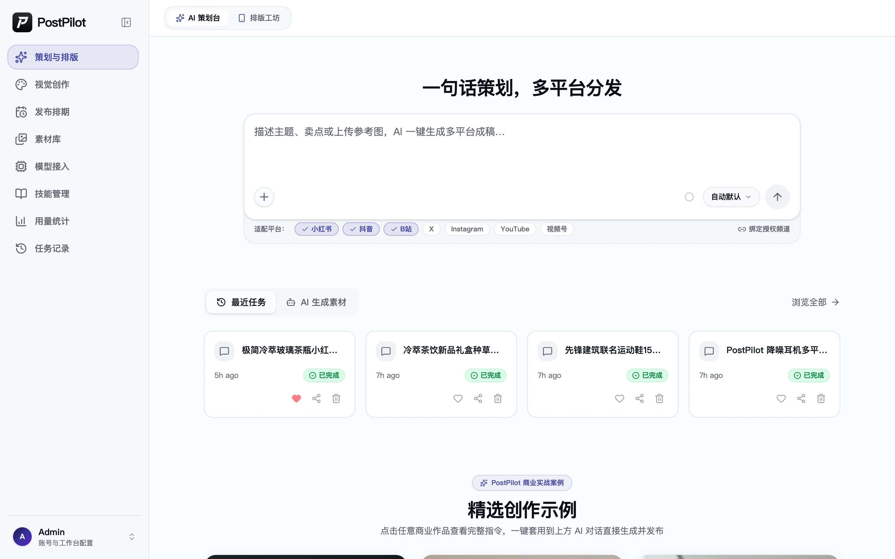
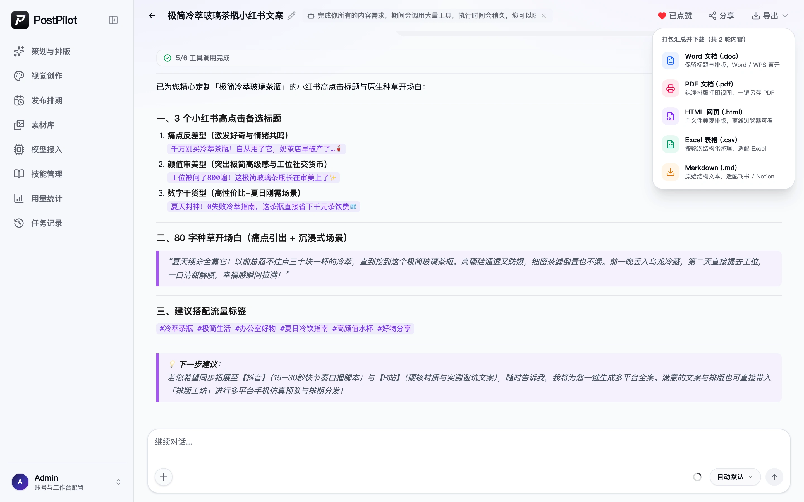
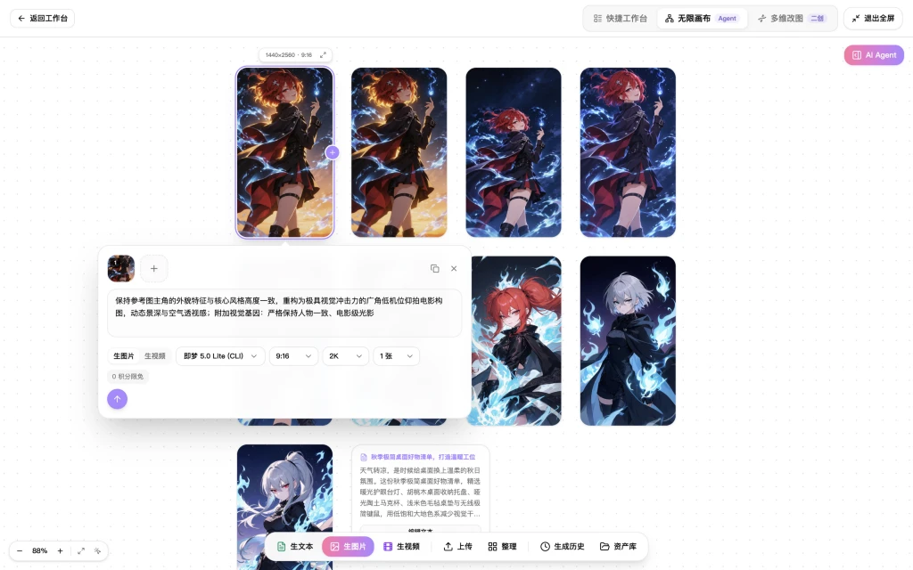
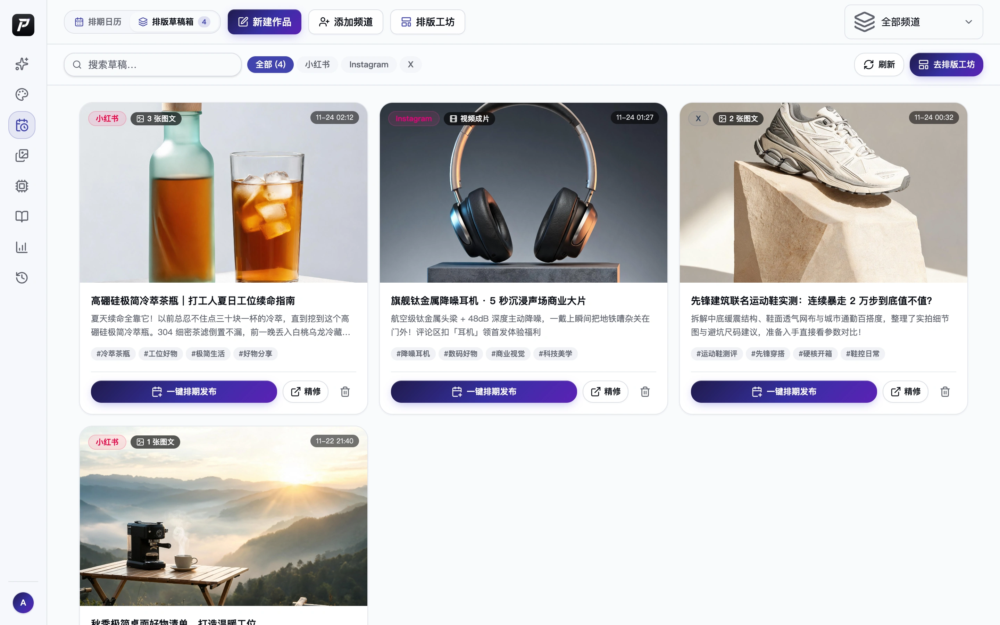
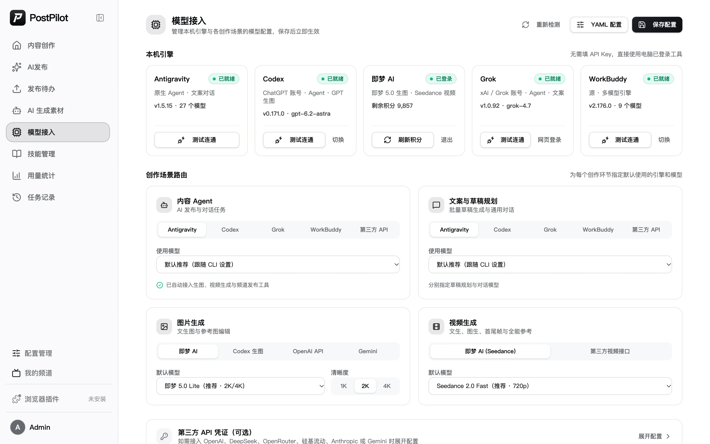
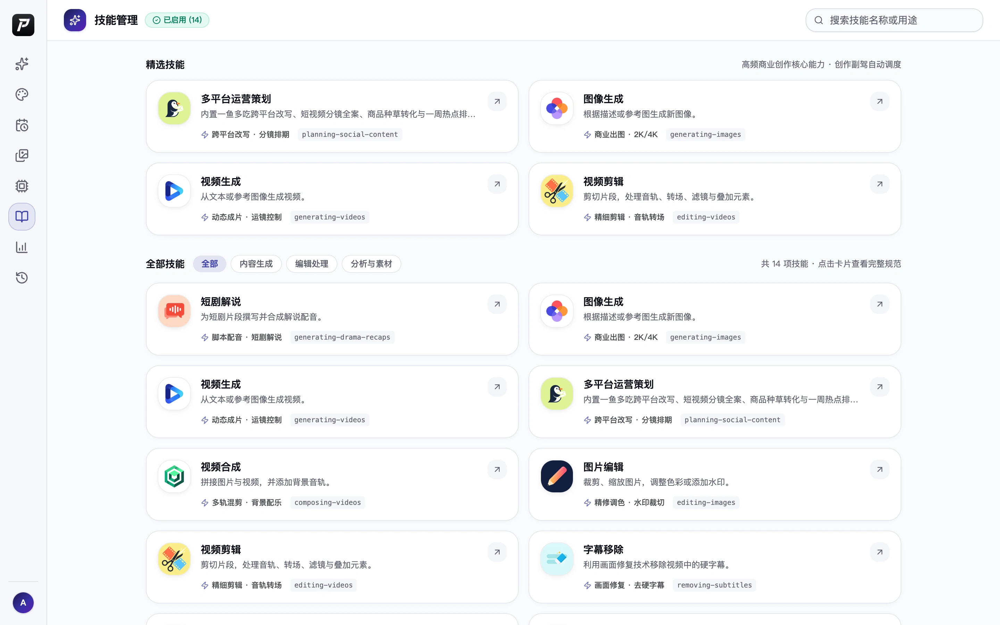

<div align="center">


# PostPilot · AI 内容策划、视觉创作与多端排期工作台

**面向品牌营销、电商视觉与自媒体团队的一体化本地优先 AI 内容生产与分发工作台**  
打通 **AI 运营策划与五格式导出 → 7 平台仿真手机排版工坊 → 快捷生图 / 无限画布 / 多维改图 → 排期日历与专用排版草稿箱 → 14 项内置技能与本机多模型路由** 全链路闭环。

[](https://foldframe-studio.vercel.app)
[](https://www.huangxiyuan.net/projects/postpilot)
[](./LICENSE)

<br />



</div>

---

## 核心价值：为什么做 PostPilot？

大多数 AIGC 工具只停留在「聊一句、出一张图」，真正落地品牌内容运营或自媒体矩阵时，创作者往往需要在 **文案工具、生图/视频工具、精修软件、手机排版预览、多个社媒发布后台** 之间频繁切换。

**PostPilot** 基于开源项目 [AiToEarn](https://github.com/yikart/AiToEarn) 深度重构，解决四个关键断层：

| 核心能力 | 解决的痛点 | PostPilot 的做法 |
| :--- | :--- | :--- |
| **1. 策划与排版深度解耦又一键联动** | 聊出来的方案难落地、做好图还要到处手动裁比例与复贴文案 | 「AI 策划台」专注跨平台一鱼多吃与 **Word/PDF/HTML/Excel/MD 打包导出**；「排版工坊」专注 **7 平台仿真手机预览**，一键存入草稿箱或直接排期发布 |
| **2. 商业视觉三模式协同生产** | 产品精修图、写实人像、海报与短视频需要反复改镜头、改光影、做系列延展 | 提供 **快捷工作台 + 无限画布（支持 @ 引用与多模型） + 6 维自定义改图**，主体稳定可控 |
| **3. 排期日历 + 专用「排版草稿箱」闭环** | 排版完的内容缺少暂存管理，排期时反复重填标题、正文与多图 | 「发布排期」顶部内置 **排期日历 / 排版草稿箱** 双视图；点击日历任意时间格即可排期，弹框左栏草稿箱支持 **一键填入** 右侧多平台发布区 |
| **4. 本机多模型自由桥接 + 14 项技能广场** | 团队各自订阅了不同 AI 工具，中转 API 配置繁琐且成本高 | 通过宿主机桥接服务直连本机 **Antigravity、Codex、即梦 AI（实时积分）、Grok 与 WorkBuddy**，顶部快捷接入国内外第三方 API，分场景独立配置模型与思考强度 |

---

## 8 大核心模块演示

### 1. AI 运营策划台 & 对话五格式打包导出

- **一鱼多吃跨平台策划**：勾选小红书、抖音、B站、X、Instagram、YouTube、视频号，一句话或上传产品图即可产出各端原生语感标题、正文与标签。
- **右下角紧凑调控**：输入框右下角集成上下文 token 占比镂空圆环与逐层零闪烁模型选择器（仅显示模型名与思考强度，鼠标移出自动收起）。
- **点赞筛选 + 五格式打包导出**：对话页统一红心「点赞」便于在任务记录筛选优质策划，顶栏一键打包下载 **Word（`.doc`）、PDF、HTML、Excel（`.csv`）、Markdown（`.md`）**。




---

### 2. 仿真手机排版工坊：7 平台实时预览 + 一键排期发布

- **图文 / 视频严格分流**：支持小红书、抖音、B站、X、Instagram、YouTube、视频号 7 大平台成片页与发现页封面流实时同步预览。
- **竖排比例与裁剪工具**：手机右侧提供 `3:4 / 1:1 / 4:3 / 原图` 切换、拖动微调构图、自由裁剪与 AI 一键重构比例。
- **双出口闭环**：底部同时提供 **「存入草稿箱」** 与 **「一键排期发布」**，保存后自动携带完整图文/视频与话题跳转发布弹框。


---

### 3. 视觉创作工作台：商业主图、写实人像、海报与宣传短片

一站生成电商产品精修图、写实人物照、品牌广告与 Seedance 商业宣传短视频；支持参考图拖拽与参数明细透明复盘。


---

### 4. 无限画布：全屏铺陈比稿、节点衍生与画布 Agent 协作

自动收起导航提供沉浸视野，所有商业图片与短视频居中排布；支持多素材连线衍生、拖拽本地文件、画布 Agent 对话 `@` 引用以及文/图/视频多模型切换。



---

### 5. 多维改图：6 维细化画风与穿搭预设 + 专业自定义输入

围绕中心主体按 `换镜头角度`、`换光影氛围`、`换背景场景`、`换画风质感（真人 / 2D / 3D 细分流派）`、`换穿搭造型`、`换表情动作` 六维可控微调，**全部维度支持自定义输入**，并支持一键批量出图与首尾帧转视频。


---

### 6. 发布排期日历 & 专用「排版草稿箱」

- **清晰日历交互**：周视图明确标注周数与起止日期、保留公历节日，**点击日历任意空白单元格即可按该时间点直接排期发布**。
- **专用排版草稿箱**：顶栏一键切换「排期日历 / 排版草稿箱」，且发布弹框左栏即专用草稿箱，支持搜索/平台筛选、**「一键填入」** 右侧发布区以及回跳排版工坊「精修」，覆盖 13+ 国内外主流社媒平台。




---

### 7. 模型接入中心：5 大本机直连 + 第三方 API 快捷条 + 思考强度路由

顶部优先展示 **Antigravity、Codex（GPT）、即梦 AI（实时剩余积分）、Grok、WorkBuddy** 直连状态与 **国内外第三方 API 快捷接入条**（DeepSeek / 硅基流动 / 智谱 GLM / 通义千问 / OpenAI / Anthropic / Gemini / OpenRouter）；下方四大创作场景独立拆分 **「使用模型」与「思考强度 / 清晰度」**。



---

### 8. 技能管理广场：14 项内置商业创作工作流

内置多平台运营策划、图像生成、视频生成、短剧解说、视频剪辑、多轨合成、图片精修、字幕移除、风格转绘、出海翻译、视频拆解、封面提取等 **14 项标准化技能**，配备全新统一设计的清新扁平 App 图标体系。



---

## 本机引擎与模型支持一览

| 引擎 | 接入方式 | 网页一键登录 | 适用场景 | 代表能力 |
| :--- | :--- | :---: | :--- | :--- |
| **Antigravity** | 本机多模态直连 | — | 运营策划 / 文案规划 / 识图 | Gemini 4 / Gemini 3.8 系列 + 多档思考强度 |
| **Codex (GPT)** | 本机账号直连 | ✅ | 策划写作 / 商业生图 | GPT-6.2 Astra / GPT Image 2 |
| **即梦 AI** | 本机直连 + 实时积分 | ✅ | 商业生图 2K/4K / 宣传短视频 | Seedream 5.0 Lite / Seedance 2.0 |
| **Grok** | 网页授权直连 | ✅ | 社媒文案 / 热点创意 | Grok 4.7 系列 |
| **WorkBuddy** | 本机国产多模型直连 | ✅ | 中文爆款策划 / 多模型协作 | 国产旗舰多模型 |
| **第三方 API** | 顶部快捷填入 API Key | — | 任意云端模型混配 | DeepSeek / 硅基流动 / OpenAI / Claude / Gemini / OpenRouter |

---

## 本地一键启动（Docker + 本机桥接）

```bash
# 1. 启动全套容器（Next.js Web + NestJS AI/Server + MongoDB + Redis + RustFS + Nginx）
docker compose -p aitoearn --env-file .local-run/env -f docker-compose.yml -f scripts/compose.local.yaml up -d

# 2. 启动宿主机模型桥接服务（提供本机 Antigravity / Codex / 即梦 / Grok / WorkBuddy 能力）
set -a && source .local-run/env && set +a && node scripts/local-bridge.mjs
```

启动完成后访问 `http://localhost:8080` 即可使用。
