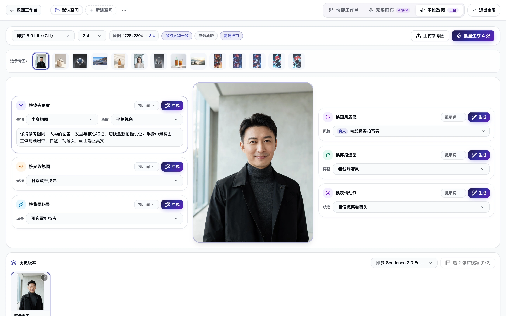
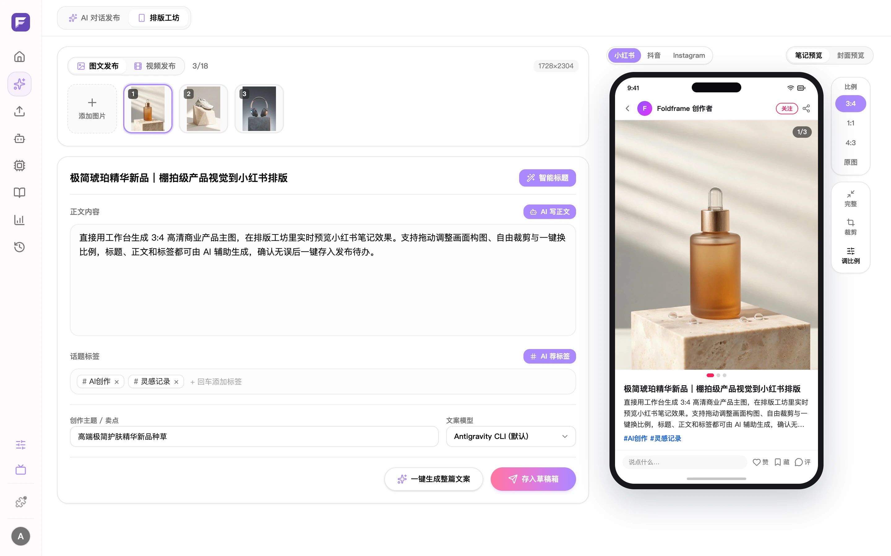
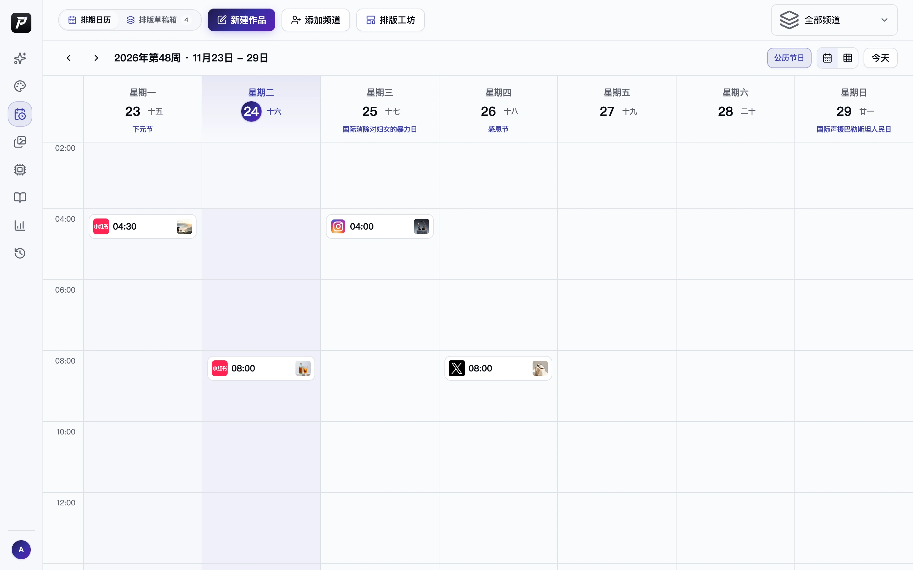

<div align="center">

# Foldframe · AI 内容创作与多端发布工作台

**面向品牌营销、电商视觉与自媒体团队的一体化 AI 内容生产与分发工作台**  
把**商业生图 / 短视频制作 → 无限画布二创 → 仿真手机排版 → 13+ 社媒平台发布待办 → 本机多模型接入**整合进同一套工作流。

[](https://foldframe-studio.vercel.app)
[](https://www.huangxiyuan.net/projects/foldframe)
[](./LICENSE)

<br />


</div>

---

## 核心作用：为什么做 Foldframe？

市面上大多数 AIGC 工具只停留在「聊一句、出一张图」，真正要做品牌内容运营或自媒体矩阵时，团队往往要在 **生图工具、视频工具、修图软件、排版预览、多个社媒后台** 之间来回切换。

**Foldframe** 基于开源项目 [AiToEarn](https://github.com/yikart/AiToEarn) 深度重构，核心解决三个实际问题：

| 核心价值 | 解决的痛点 | Foldframe 的做法 |
| :--- | :--- | :--- |
| **1. 从创作到发布全链路闭环** | 做好图和文案后，还要手动裁比例、看手机效果、逐个平台上传排期 | 把**内容创作 → 手机仿真排版 → 13 个主流平台发布待办**打通在同一个工作台，图文与视频严格分离流转 |
| **2. 面向真实商业视觉生产** | 商业产品图、写实人物、品牌广告、宣传短视频需要反复改镜头、改光影、配多种比例 | 提供**快捷工作台 + 无限画布 + 多维改图**三种模式，保住主体不走样地高效出多版商用素材 |
| **3. 本机多模型自由桥接，不被单一厂商锁定** | 团队成员常各自订阅了不同工具，统一买云端中转 API 成本高且配置繁琐 | 内置宿主机桥接服务，免填 API Key 直连电脑已登录的 **Antigravity、Codex、即梦 AI、Grok（网页登录）与腾讯 WorkBuddy**，也可按需混配第三方 API |

---

## 核心功能演示（1 → 7）

### 1. 快捷工作台：写实商业图、品牌海报、短视频与文案草稿一站生成

输入一句话或拖入商品参考图，就能直接生成**电商产品精修图、真实人物照、品牌视觉海报、商业宣传短视频**以及结构化社媒文案草稿。

- **模型按任务分流**：「生成草稿（图文 / 视频）」直连大语言模型规划标题、正文与分镜，生图与生视频走独立多模态管线，避免误调用图像模型写文案。
- **参数与明细透明**：点击任意作品即可查看右侧「生成详情」，清晰记录所用模型、提示词、画幅比例、分辨率、耗时与真实积分消耗。


---

### 2. 无限画布：把多张素材摆在一起对比、连线衍生和批量改图

面对品牌广告、系列海报、商品套图等需要反复比稿的场景，进入无限画布后会自动收起导航栏并居中排布素材，提供全屏级创作视野：

- **节点连线继续创作**：支持图片与图片、图片与视频之间直接连线作为参考，选中节点即可在下方就近修改提示词、切换模型、比例、清晰度与生成数量。
- **底部工具栏与抽屉**：集成「生文本 / 生图片 / 生视频」、生成历史与资产库抽屉，支持平滑阻尼缩放与画布拖拽。


---

### 3. 多维改图：保住商品和人物不走样，按 6 个维度一键出变体

选定一张满意的主体图（如商业人像或产品精修图），无需从零反复写长提示词，直接围绕中心原图从六个实用维度批量微调：

- **六大可控维度**：`换镜头角度`、`换光影氛围`、`换背景场景`、`换画风质感`、`换穿搭造型`、`换表情动作`。
- **小白友好、专业可控**：每个维度均内置常用景别、角度、光线与风格下拉预设，同时支持展开自定义提示词与一键批量生成，参考图支持二次确认删除。



---

### 4. 仿真手机排版工坊：发小红书、抖音、Instagram 前直接看真实效果

将排版环节归入「AI 发布」流程，入口严格隔离 **图文发布** 与 **视频发布**，避免图/视频逻辑混杂：

- **仿真手机实时预览**：右侧放大展示小红书、抖音、Instagram 的笔记页与封面页效果，修改标题、正文、话题标签时手机画面实时同步。
- **竖排比例调整与 AI 辅助**：手机右侧竖排比例栏整合 `3:4 / 1:1 / 4:3 / 原图` 切换、完整/铺满展示、框选自由裁剪与按比例重构；左侧支持 AI 一键写标题、写正文、推荐标签，确认后直接存入发布待办。



---

### 5. 发布待办与 13 个主流平台连接：从做完内容到定时分发一步到位

Foldframe 不止于内容生成，而是真正落地到多端分发执行。支持统一接入 **13 个国内外主流内容平台**：

- **国内平台**：小红书、微信视频号、微信公众号、抖音、快手、Bilibili。
- **海外平台**：YouTube、TikTok、Instagram、Facebook、Threads、LinkedIn、Pinterest。
- **统一排期管理**：排版工坊保存的草稿自动进入发布待办，便于品牌运营与内容团队集中审核、定时发布与管理多平台账号。



---

### 6. AI 生成素材库：商业图、人像、视频按类型与画面比例有序管理

所有生成与二创的商业产品图、写实人像、海报与短视频均自动归档至素材库：

- **多维快速筛选**：支持按类型（`全部 / 图片 / 视频`）与画面比例（`竖版 / 横版 / 方图` 及 `9:16 / 3:4 / 4:5 / 1:1 / 4:3 / 16:9`）秒级检索。
- **像素规格清晰标注**：自动识别并展示每份素材的分辨率与比例角标，可一键送入多维改图、无限画布或排版工坊复用。


---

### 7. 本地模型接入：直连本机 Antigravity、Codex、即梦、Grok 与 WorkBuddy

无需填写繁琐的中转 API Key，通过宿主机桥接服务 `scripts/local-bridge.mjs` 直接复用电脑本机已登录的主流 AI 工具，同时保留完整的第三方 API 接入能力：

- **五大本机引擎一站管理**：自动检测安装版本、登录态、模型列表与剩余积分，支持页面内一键测试连通。
- **网页一键跳转登录**：**即梦 AI**、**Codex**、**Grok** 与 **WorkBuddy** 均内置图形化网页授权向导（无需敲终端命令），点击按钮跳转浏览器确认即可自动同步登录态。
- **分场景灵活路由**：为「内容 Agent」、「文案与草稿规划」、「图片生成」、「视频生成」四个创作环节分别指定默认引擎与模型，保存即生效。


---

## 本机引擎与模型支持一览

| 引擎 | 接入方式 | 网页一键登录 | 适用场景 | 代表模型 |
| :--- | :--- | :---: | :--- | :--- |
| **Antigravity (`agy`)** | 本机 CLI 自动发现 | 本机已登录自动复用 | 内容 Agent / 文案规划 / 对话 | Gemini / Claude 系列等 |
| **Codex (`codex`)** | 本机 CLI 自动发现 | ✅ OpenAI 设备网页授权 | 内容 Agent / 文案 / GPT 生图 | GPT-5.x / `GPT Image 2` |
| **即梦 AI (`dreamina`)** | 本机 CLI 自动发现 | ✅ 即梦网页授权（支持扫码） | 商业生图 / 图生图 / 短视频 | 即梦 `5.0 Lite / 5.0 Pro`、`Seedance 2.0 / 2.5` |
| **Grok (`grok`)** | 本机 CLI 自动发现 | ✅ xAI 网页授权 + 确认码 | 内容 Agent / 文案规划 / 对话 | `grok-4.7`、`grok-4.7-build-fast`、`grok-4.6` |
| **WorkBuddy** | 本机桌面端内置引擎 | ✅ 微信扫码（国内版）/ 国际版 | 内容 Agent / 文案规划 / 对话 | `auto`、`glm-5.1`、`kimi-k2.5`、`minimax-m2.7`、`deepseek-v3-2-volc` |
| **第三方 API（可选）** | 自定义 Base URL + API Key | — | Agent / 文案 / 生图 / 视频 | OpenAI、Anthropic、Gemini、DeepSeek、OpenRouter、硅基流动、火山方舟、阿里百炼 |

---

## 目录结构

```text
.
├── project/
│   ├── aitoearn-web/        # Next.js 14 前端工作台（内容创作 / 排版工坊 / 发布待办 / 模型接入）
│   └── aitoearn-backend/    # NestJS 微服务（aitoearn-ai / aitoearn-server / 共享库）
├── scripts/
│   ├── compose.local.yaml   # 本地 Docker Compose 编排配置
│   ├── local-bridge.mjs     # 宿主机多模型 CLI 桥接服务（支持 agy/codex/dreamina/grok/workbuddy）
│   └── local-bridge.test.mjs# 本地桥接单元测试
├── showcase/                # 独立静态产品展示页（部署于 Vercel）
│   └── images/              # 2x Retina（2880×1800）高清功能演示截图
├── 启动本地版.command         # macOS 一键启动脚本（自动拉起桥接与 Docker 容器）
└── 本地使用说明.md            # 本地运行与模型接入详细指南
```

## 快速本地启动（macOS）

详细说明见 [本地使用说明.md](./本地使用说明.md)。确保已安装 Docker Desktop 后，在仓库根目录直接运行：

```bash
./启动本地版.command
```

启动完成后访问 `http://localhost:8080/zh-CN`，进入左侧「模型接入」即可一键网页登录即梦 AI、Codex、Grok 或 WorkBuddy 开始创作。

## License

基于开源项目 [yikart/AiToEarn](https://github.com/yikart/AiToEarn)（MIT License）二次开发。
